# DSO202 — Practical 6 Report
## Helm: Consuming, Writing, Configuring and Validating Charts (Unit III 3.2)

---

## 1. Objective

This practical uses **Helm 4**, the package manager for Kubernetes. It covers both sides of Helm: consuming a published chart as a *release* with a recorded revision history, and writing, configuring and validating my own chart.

It follows the Demo Stages of Unit III 3.2 (sections 3.2.1–3.2.3) on the three-node `kind` cluster from Practical 1:

0. Installing and checking Helm, and preparing the cluster
1. Consuming a published chart (`podinfo`): repository, search, read, install, inspect, the release record, the upgrade values-loss failure, `--reuse-values`, rollback and uninstall
2. The chart skeleton: the `helm create` scaffold and the `webapp` chart's `Chart.yaml`, `values.yaml` and `.helmignore`
3. Writing the `webapp` templates: helpers, ConfigMap, Deployment (with a checksum annotation), Service, NOTES and a test Pod
4. Values precedence: `--set` over `-f`, deep merging, environment-file layering, `--set` type conversion and `null` deletion
5. Chart validation: four deliberate failures (missing required value, bad indentation, a number where a string was meant, a misspelled Kubernetes field), the values schema that fixes them, and a final check of every environment

---

## 2. Environment

| Component | Value |
|---|---|
| Host OS | Kali GNU/Linux Rolling, kernel `7.1.5+kali-amd64` |
| Container runtime | Docker Engine `29.9.2` (native daemon) |
| Cluster | `kind` cluster `dso202` from Practical 1 (`cluster/kind-cluster.yaml`, host port `30080` mapped); context `kind-dso202` |
| Kubernetes | `v1.36.1` on `control-plane`, `worker-node-1`, `worker-node-2` |
| Helm | **`v4.3.1`** (`KubeClientVersion: v1.37`) |
| kubectl | `v1.36.5` |
| Published chart | `podinfo/podinfo` **6.15.0** (pinned), from `https://stefanprodan.github.io/podinfo` |
| Own chart | `webapp` 0.1.0, `appVersion "1.30-alpine"` (`nginx:1.30-alpine`) |
| Lab directory | `dso202-helm-lab/` (`webapp/` chart and `environments/` values files) |

**Deviations from the notes, and why:**

- **Release namespace `dso202-helm-p6` instead of `dso202-helm`.** My cluster already had a `dso202-helm` namespace holding an unrelated release (`my-argo`, Argo Workflows, installed 10 days earlier). Using a separate namespace kept that release untouched. It also made Stage 1's "nothing left behind after uninstall" check meaningful, because only this practical's objects lived in the namespace.
- **Helm `v4.3.1`** is installed rather than the notes' `v4.3.0`. This is a patch release, so commands and output formats are the same.
- **Newer podinfo versions exist** (6.16.0 and 6.17.0 were published after the notes were written). Every command pins `--version 6.15.0`, so the results match the notes.
- The Practical 1 NodePort `30080` is still held by `dso202-assignment-01/frontend-svc`. This doesn't affect Stages 0–5, because the `webapp-dev` NodePort release is only *rendered* here, never installed.

### Repository layout

```
DSO202-Practical-06/
├── README.md                       ← this report
├── dso202-helm-lab/
│   ├── environments/
│   │   ├── dev.yaml                ← dev overrides (NodePort 30080, 1 replica)
│   │   └── prod.yaml               ← prod overrides (3 replicas, larger resources)
│   └── webapp/                     ← the chart written in Stages 2–5
│       ├── Chart.yaml  values.yaml  values.schema.json  .helmignore
│       ├── charts/
│       └── templates/  _helpers.tpl configmap.yaml deployment.yaml service.yaml NOTES.txt tests/test-connection.yaml
├── evidence/                       ← full rendered manifests, release-record dump
└── screenshots/                    ← terminal evidence used below
```

---

## 3. Procedure and Observations

### Demo Stage 0 — Installing Helm and preparing the cluster

```
kubectl config current-context
kubectl get nodes
grep -rs baltocdn /etc/apt/sources.list /etc/apt/sources.list.d/ || echo 'no baltocdn source'
helm version
helm env | grep -E 'HELM_(NAMESPACE|MAX_HISTORY|REPOSITORY_CONFIG|REPOSITORY_CACHE|REGISTRY_CONFIG)'
helm list -A
```

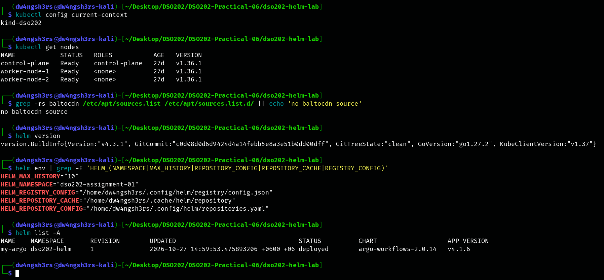

**Observation:** the context `kind-dso202` reaches the three `Ready` nodes. `helm version` reports **v4.3.1**. Its `KubeClientVersion: v1.37` is the client library Helm was built with, not the cluster version (v1.36.1). No APT source points to the retired `baltocdn.com` mirror. `HELM_MAX_HISTORY="10"` limits each release to ten stored revisions.

`HELM_NAMESPACE` is `dso202-assignment-01`, not `default` as in the notes. Helm takes its default namespace from the kubeconfig context, and my context's default namespace was set in the Assignment. That is why every command below passes `-n` explicitly. `helm list -A` worked against the cluster and listed only the pre-existing `my-argo` release.

### Demo Stage 1 — Consuming a published chart (`podinfo`)

**Steps 1–3: add the repository, search it, and read the chart before installing it:**

```
helm repo add podinfo https://stefanprodan.github.io/podinfo
helm repo update podinfo
helm search repo podinfo --versions | head -4
helm show chart podinfo/podinfo --version 6.15.0
helm show values podinfo/podinfo --version 6.15.0 | head -20
```

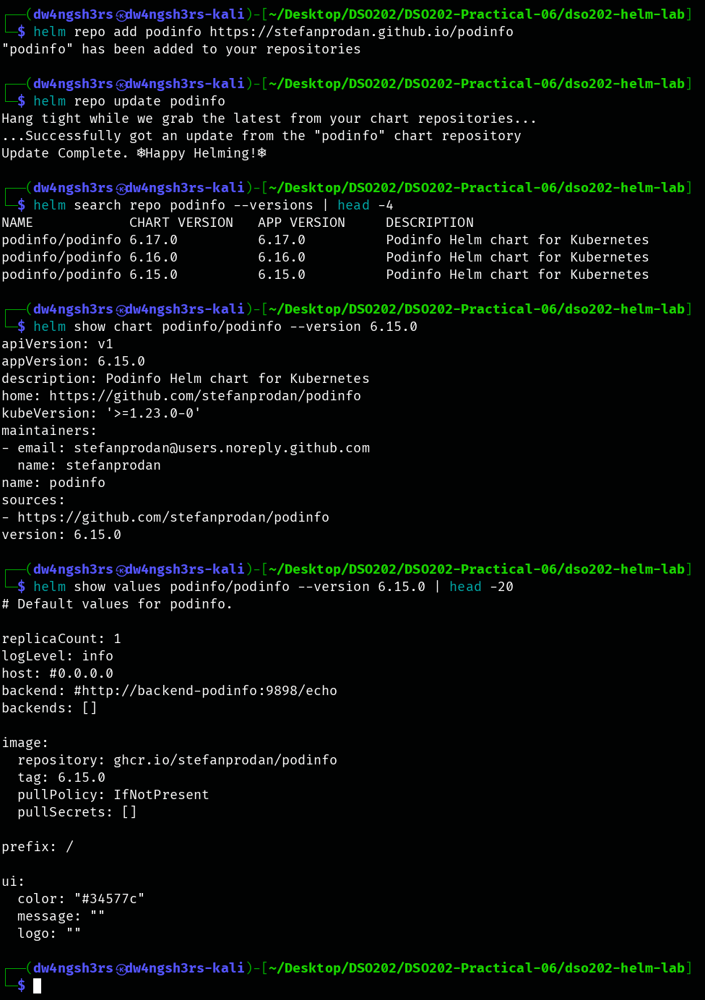

**Observation:** `helm repo add` only recorded the URL. `helm repo update` downloaded the index that searches read. The search lists **6.17.0 and 6.16.0 above 6.15.0**: two newer releases appeared after the notes were written. This proves the pitfall about omitting `--version` — without the pin, the "same" command would now install different software. The chart declares `apiVersion: v1`, the legacy Helm 2 format that Helm 4 still installs. `helm show values` shows the configuration interface, including `replicaCount: 1` and `ui.message: ""`, the two values overridden next. CHART VERSION and APP VERSION are separate columns. Here they happen to be equal.

**Steps 4–6: install as release `my-podinfo`, list it, and reach the application:**

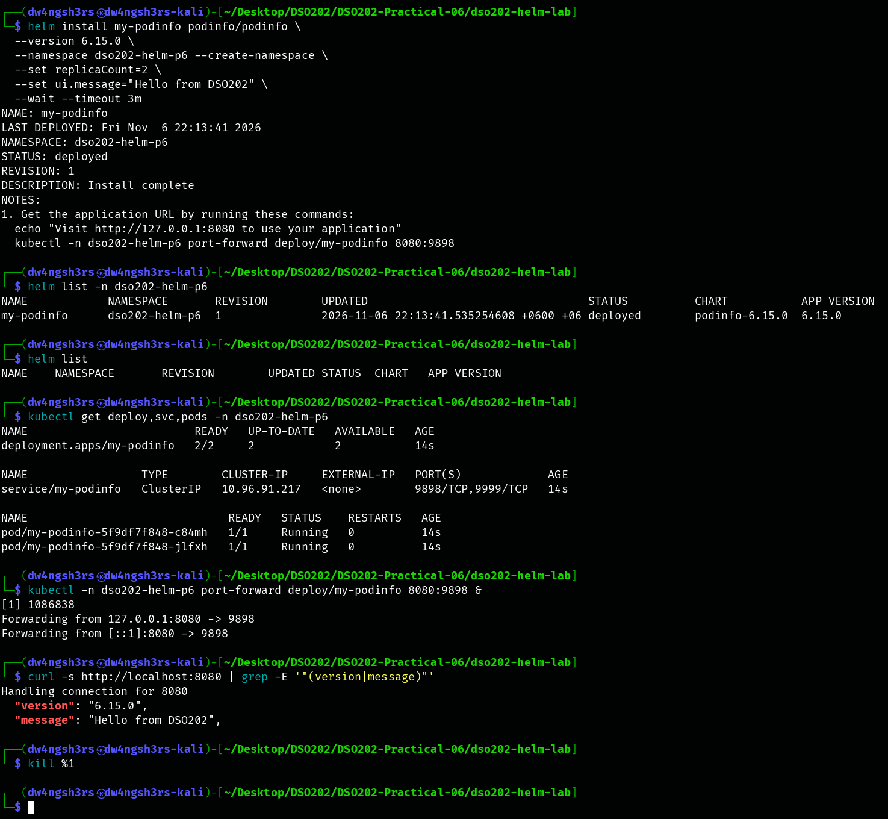

**Observation:** the install returned `STATUS: deployed`, `REVISION: 1` and the chart's rendered `NOTES:`. `--wait` meant Helm returned only after the Deployment reported **2/2** ready. `helm list -n dso202-helm-p6` shows the release. Plain `helm list` prints only headings, because releases are namespaced and the current namespace is different. Through `port-forward`, podinfo returned `"version": "6.15.0"` and `"message": "Hello from DSO202"`, which proves the `--set` overrides reached the running application.

**Step 7: inspect the release:**

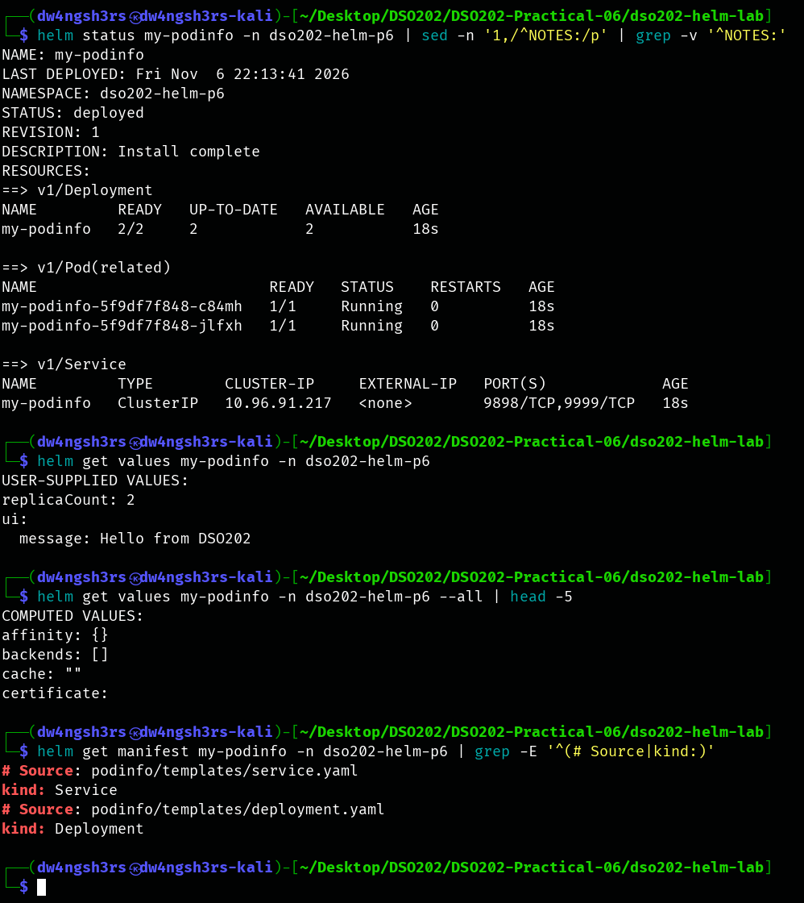

**Observation:** in Helm 4, `helm status` includes a `RESOURCES:` section listing the live Service, the Deployment and its related Pods. `helm get values` shows only the two user-supplied values, while `--all` prints the complete `COMPUTED VALUES` (chart defaults plus user values). `helm get manifest` shows exactly what was sent to the API server, with a `# Source:` comment naming the template that produced each object.

**Step 8: the release record:**

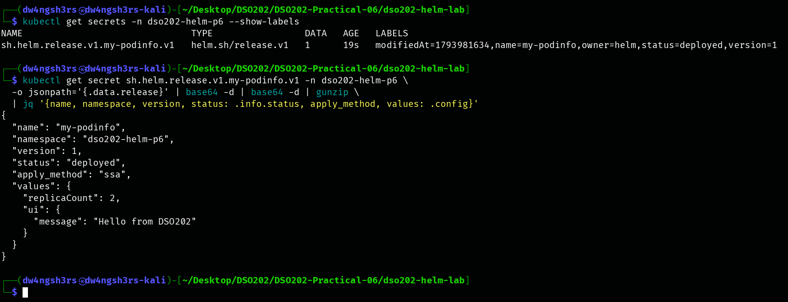

**Observation:** revision 1 is stored as the Secret `sh.helm.release.v1.my-podinfo.v1`, of type `helm.sh/release.v1`, labelled `owner=helm,name=my-podinfo,status=deployed,version=1`. Decoding it needs **two** base64 decodes (Helm's own, then Kubernetes' Secret encoding) and a gunzip. The JSON shows `"apply_method": "ssa"` (Helm 4 created the release with server-side apply) and the user values in plain text. **Anyone allowed to read Secrets in the namespace can recover every value given to a release**, so Helm does not keep secrets secret. (Decoded record without chart templates: `evidence/release-record-my-podinfo-v1.json`.)

**Steps 9–10: the values-loss upgrade failure, and the fix:**

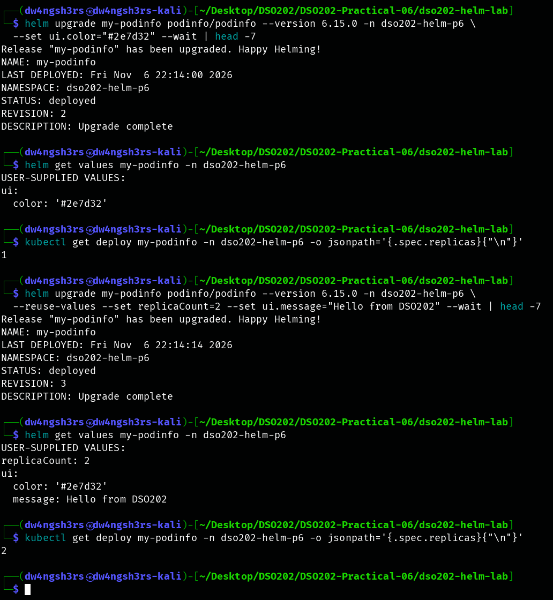

**Observation:** the deliberately incomplete upgrade (`--set ui.color="#2e7d32"` only) **succeeded as revision 2**. Yet the user values became only `ui.color`, and the Deployment dropped **from 2 replicas to 1**. The install-time `replicaCount` and `ui.message` were discarded silently, because `helm upgrade` with any value flag starts again from the chart defaults. Repeating the upgrade with `--reuse-values --set replicaCount=2 --set ui.message=…` (revision 3) merged the previous values with the new ones. All three keys were present and replicas returned to 2.

**Steps 11–12: rollback, history, and uninstall:**

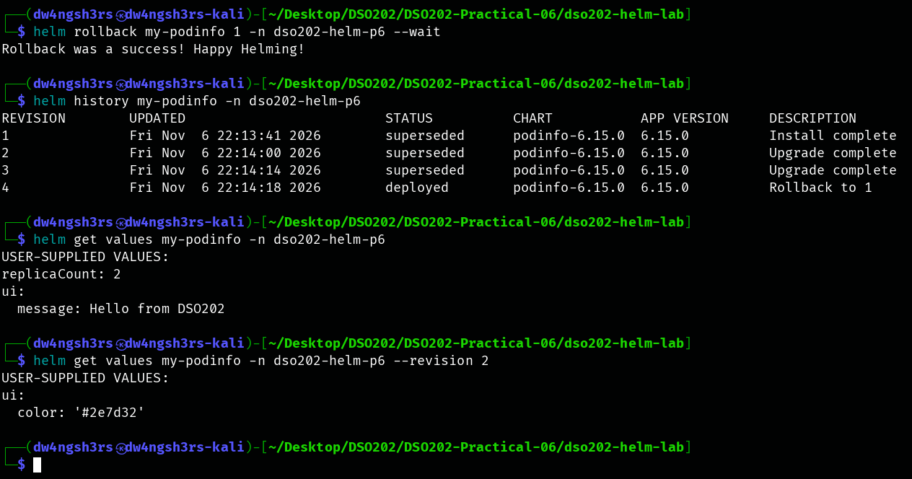

**Observation:** `helm rollback my-podinfo 1` did **not** rewind the history. It created **revision 4** (`deployed`, description `Rollback to 1`) and marked revisions 1–3 `superseded`. Revision 4's values are revision 1's (`replicaCount: 2`, `message`, and no colour). Past values are still readable: `--revision 2` shows the colour-only values that caused the incident.

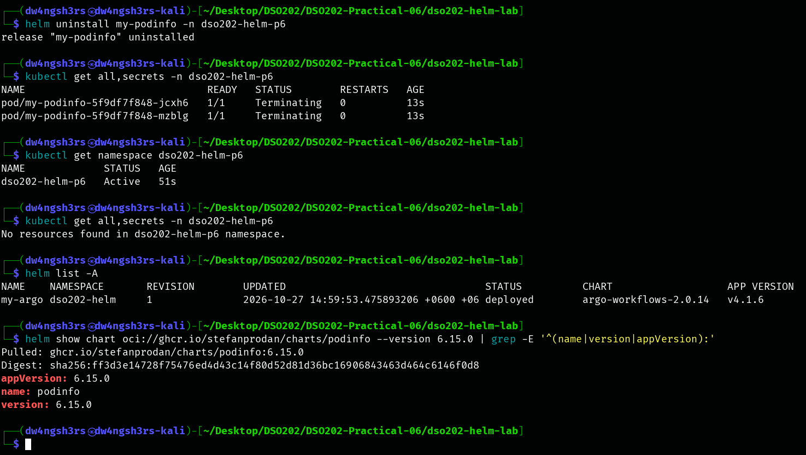

**Observation:** `helm uninstall` returned immediately, so the first `kubectl get` still showed the two Pods `Terminating` (uninstall does not wait unless asked). Seconds later the namespace held **no resources and no `sh.helm.release` Secret**: every object and every record was removed as one unit. The namespace itself stayed `Active`, because `--create-namespace` does not make the namespace part of the release. `helm list -A` shows only the unrelated `my-argo` release. Finally, the same chart was read straight from its **OCI registry** (`oci://ghcr.io/stefanprodan/charts/podinfo`) with no `repo add` or `repo update`. Helm printed the artifact's immutable `sha256` **digest** for tag `6.15.0`.

**Stage 1 checkpoint met:** add, search, read, install, inspect, upgrade (including the values-loss failure), roll back and uninstall were all run, and the four-row history table from Step 11 was reproduced.

### Demo Stage 2 — The chart skeleton

**The reference scaffold:**

```
helm create scaffold
find scaffold -type f | sort
rm -rf scaffold
```

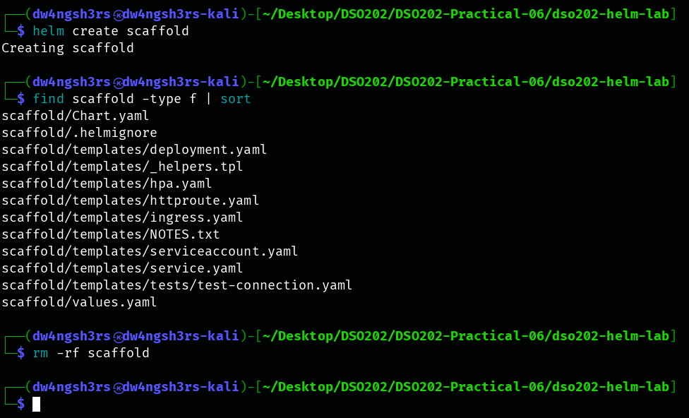

**Observation:** the Helm 4 scaffold includes `httproute.yaml` for the Gateway API alongside `ingress.yaml`, plus `hpa.yaml`, `serviceaccount.yaml` and a test Pod. It is a useful reference, but it uses many features at once. It was removed, and the smaller `webapp` chart was built file by file instead.

**The `webapp` chart:**

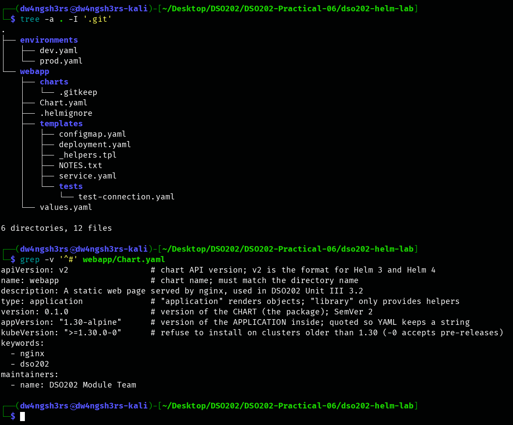

**Observation:** the chart directory name matches `name: webapp`. It uses `apiVersion: v2`, the Helm 3/4 format, unlike podinfo's legacy `v1`. It separates `version: 0.1.0` (the *package*) from `appVersion: "1.30-alpine"` (the *software*). `appVersion` is quoted, so YAML keeps it as the string `1.30-alpine` (Stage 5 shows what happens to an unquoted `1.30`). `kubeVersion: ">=1.30.0-0"` refuses clusters older than 1.30. Its `-0` suffix also accepts pre-release builds. `values.yaml` documents every key, and `page.environment` deliberately has no default.

### Demo Stage 3 — Writing the `webapp` templates

The templates (`webapp/templates/`) follow the industry conventions from the notes:

- **`_helpers.tpl`** defines `webapp.name`, `webapp.fullname` (truncated to 63 characters, and avoiding `webapp-dev-webapp`), `webapp.chart`, two label sets (`webapp.selectorLabels`, which is small and immutable, and `webapp.labels`, the full recommended set), and `webapp.environment`, which uses `required` so that nothing renders without an environment.
- **`deployment.yaml`** has a `checksum/config` Pod annotation (the SHA-256 of the rendered ConfigMap). It falls back from `image.tag` to `.Chart.AppVersion`, uses `toYaml … | nindent 12` for resources, and adds `with` for optional Pod annotations.
- **`service.yaml`** emits `nodePort` only when the type is `NodePort` **and** a port is given.
- **`NOTES.txt`** prints how to reach the release, and **`tests/test-connection.yaml`** is a `helm.sh/hook: test` Pod whose script is a block scalar (`|`), so that the `": "` inside it isn't parsed as YAML.

```
helm template webapp-dev ./webapp -f environments/dev.yaml --namespace dso202-dev | grep -E '^(# Source|kind:)'
helm template webapp-dev ./webapp -f environments/dev.yaml -n dso202-dev -s templates/service.yaml
helm template webapp-dev ./webapp -f environments/dev.yaml -n dso202-dev -s templates/deployment.yaml | grep -E '...'
```

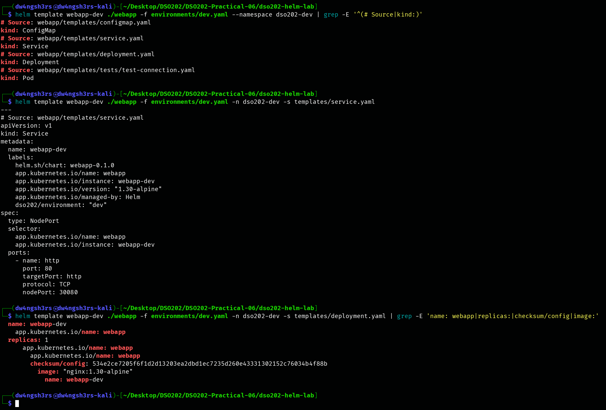

**Observations:**

1. **Object order follows kind, not file order.** The render produced exactly four objects, in the order ConfigMap → Service → Deployment → test Pod. Helm sorts by kind so that the ConfigMap exists before the Deployment that mounts it.
2. **The object name is the release name alone (`webapp-dev`).** The release name already contains the chart name, so `webapp.fullname` didn't produce `webapp-dev-webapp`.
3. **NodePort was emitted.** `dev.yaml` sets `type: NodePort` and `nodePort: 30080`, so the conditional `nodePort:` line appeared.
4. **The checksum is repeatable.** `checksum/config: 534e2ce7205f6f1d…` is **byte-for-byte the value printed in the notes**. Identical chart and values give an identical hash, which proves the chart reproduces the reference exactly.
5. **The image tag came from `appVersion`.** `image.tag` is empty, so the image resolved to `nginx:1.30-alpine`.

The full renders are saved in `evidence/rendered-webapp-dev.yaml` and `evidence/rendered-webapp-prod.yaml`.

### Demo Stage 4 — Values precedence and layering

**Step 1 and Step 2: `--set` beats `-f`; layering files in both orders:**

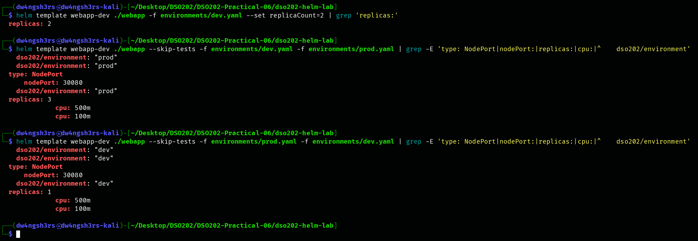

**Observations:**

- `--set replicaCount=2` overrode `dev.yaml`'s `replicaCount: 1`. `--set` always beats every `-f` file.
- **Layering is not switching.** With `-f dev.yaml -f prod.yaml` the result is labelled `prod` with 3 replicas, yet it **kept dev's `type: NodePort` and `nodePort: 30080`**, because `prod.yaml` never mentions `service`. With the files reversed, the result is a `dev` release with 1 replica that **kept prod's CPU `500m`/`100m`**, because `dev.yaml` never mentions `resources`. Maps merge deeply key by key, so the keys a later file leaves out are inherited from the earlier file. Each environment file must be applied on its own on top of the chart defaults.

**Step 3 and Step 4: `--set` type conversion and `null` deletion:**

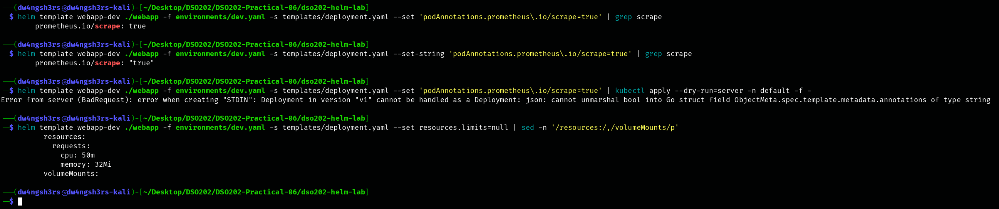

**Observations:**

- `--set 'podAnnotations.prometheus\.io/scrape=true'` rendered an **unquoted boolean** (`prometheus.io/scrape: true`) without any complaint. `--set-string` rendered the string `"true"`.
- Sending the boolean version to the API server (`kubectl apply --dry-run=server`) failed with `cannot unmarshal bool into … annotations of type string`, because annotation values must be strings. I had first tried `helm install --dry-run=server`, and it accepted the invalid object. That is a preview of Stage 5's finding that Helm's own dry-run does not apply strict field validation.
- `--set resources.limits=null` **deleted** the chart's default `limits` block, leaving only `requests`.

### Demo Stage 5 — Chart validation

**Failure 1: missing required value; `helm lint` does not fail:**

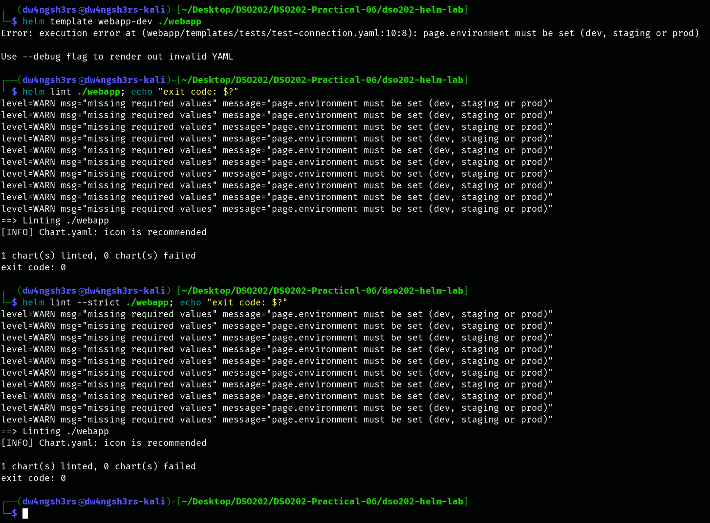

**Observation:** `helm template` with no environment file stopped with the chart's own message, `page.environment must be set (dev, staging or prod)`. The reported location is the test Pod that *included* the helper, not the helper file itself. `helm lint`, and even `helm lint --strict`, only printed `level=WARN … missing required values` and exited with **code 0**. A CI pipeline that relied on lint alone would have passed a chart that cannot render with its defaults.

**Failure 2: indentation (`toYaml` without `nindent`):**

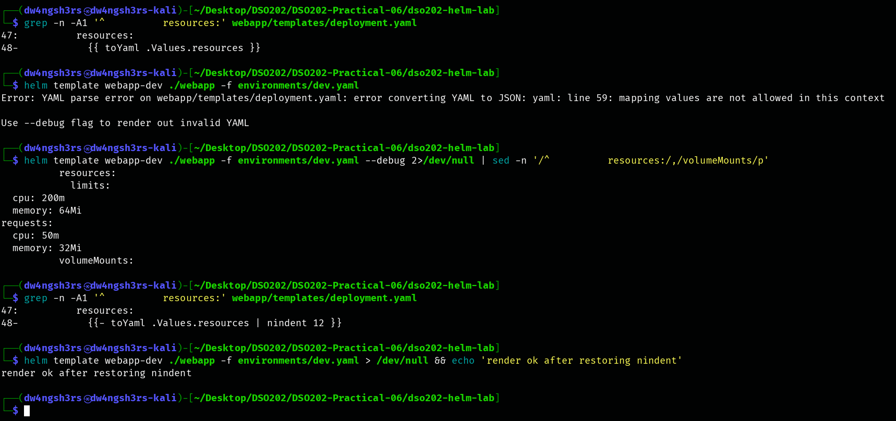

**Observation:** replacing `{{- toYaml .Values.resources | nindent 12 }}` with `{{ toYaml .Values.resources }}` gave `YAML parse error … mapping values are not allowed`. `--debug` showed the cause: only the first line (`limits:`) received the template's indentation, and `cpu`, `memory` and `requests` started at column 0. Restoring `nindent 12` fixed the render.

**Failure 3: a number where a string was meant, then the schema fix:**

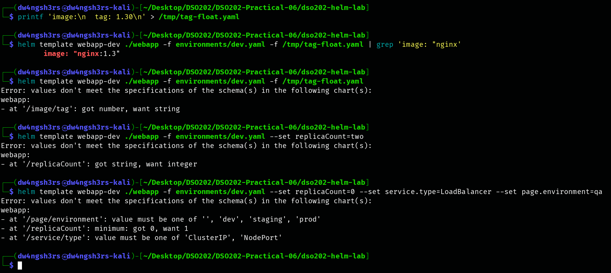

**Observation:** `tag: 1.30` in a values file was parsed by YAML as the float **1.3**. The chart rendered `image: "nginx:1.3"` **silently**, a failure that would only appear in the cluster as `ImagePullBackOff` (or as a very old image). After adding `webapp/values.schema.json`, Helm validated the merged values *before* rendering:

- the same file failed with `at '/image/tag': got number, want string`;
- `--set replicaCount=two` failed with `got string, want integer`;
- a command with three bad values (`replicaCount=0`, `service.type=LoadBalancer`, `page.environment=qa`) reported **all three violations at once**.

**Failure 4: a misspelled Kubernetes field (`replica:` instead of `replicas:`):**

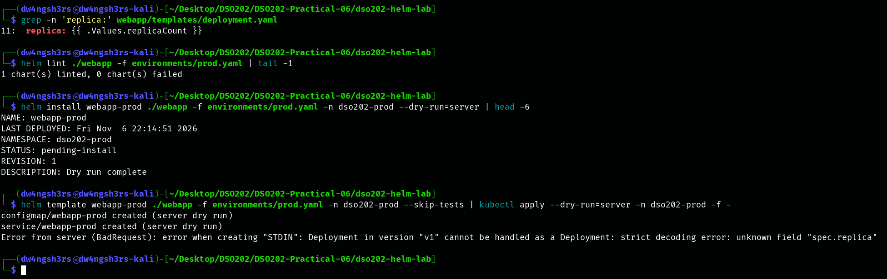

**Observation:** each check behaved differently.

- `helm lint` passed (`0 chart(s) failed`), because it checks chart structure, not Kubernetes schemas.
- `helm install --dry-run=server` also passed (`STATUS: pending-install`, `Dry run complete`).
- `helm template … | kubectl apply --dry-run=server` rejected it: `strict decoding error: unknown field "spec.replica"`. The ConfigMap and Service in the same stream were accepted, which shows that a real install would have applied some objects before failing.

`replicas:` was restored afterwards. (The `dso202-prod` namespace was created only for these dry runs and was deleted at the end of the stage.)

**Step 5: the corrected chart passes every check for every environment:**

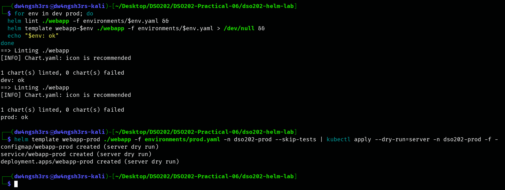

**Observation:** the loop printed `dev: ok` and `prod: ok`. The only remaining lint message is `[INFO] Chart.yaml: icon is recommended`, which is advice and does not fail the lint. As an extra check beyond the notes, the strict server dry-run now accepts all three prod objects, including `deployment.apps/webapp-prod`.

**What each check covers (confirmed in this stage):**

| Check | Missing required value | Wrong value type | Bad indentation | Unknown Kubernetes field |
|---|---|---|---|---|
| `helm lint` | Warning only (exit 0) | Yes, with a schema | Yes | **No** |
| `helm template` | Yes | Yes, with a schema | Yes | **No** |
| `helm install --dry-run=server` | Yes | Yes, with a schema | Yes | **No** |
| `helm template \| kubectl apply --dry-run=server -f -` | Yes | Yes, with a schema | Yes | **Yes** |

---

## 4. Analysis — Review Questions

**3.2.1 — Why Helm**

1. **Why does `kubectl apply -f` leave an orphaned object, and how does a release record avoid it?** `kubectl apply -f` only applies the objects that are *in the files now*. It has no memory of what it applied last time, so an object deleted from the files is simply never mentioned again and stays in the cluster with nothing managing it. Helm stores the full rendered manifest of every revision in the release record. On upgrade it compares the previous manifest with the new one and deletes objects that disappeared. On uninstall it deletes everything listed in the record (Stage 1: "No resources found").
2. **A database password in a values file: two places it can now be read.** (a) The release record Secret `sh.helm.release.v1.<release>.v<n>`, readable by `helm get values` or by decoding the Secret as in Stage 1 Step 8. (b) The values file itself in version control, plus wherever it was passed on the command line (shell history and CI logs if it was given with `--set`).
3. **Kustomize vs Helm.** Kustomize suits environment variants of manifests a team writes itself, as in Practical 5 (plain YAML, no templates, built into `kubectl`). Helm suits packaging software for other people to install and installing third-party software such as podinfo, where versioning, a configuration interface and rollback as one unit matter.

**3.2.1.2 — Architecture**

1. **The Secret for revision 7 of `payments` in `finance`:** `sh.helm.release.v1.payments.v7`, in namespace `finance`.
2. **Why removing Tiller improved security.** Tiller ran inside the cluster with broad permissions, and anyone who could reach it could act with those permissions. Since Helm 3, the client renders locally and talks to the API server with the *user's own* kubeconfig credentials. RBAC therefore applies unchanged: a user who can't create a Deployment can't install a chart containing one.
3. **Release `web` in `team-a` and in `team-b`.** Releases are namespaced (the record lives in the release's namespace), so the names don't collide. `helm list -A` lists both.

**3.2.1.4 — Consuming a chart**

1. **`helm upgrade r c --set a=1` after an install that set `b=2`:** `b` reverts to the **chart default** (or is unset), because an upgrade with any value flag starts again from the defaults. This is exactly what happened to `replicaCount` in Stage 1 Step 9. `--reuse-values` (or, better for chart-version upgrades, `--reset-then-reuse-values`) would have kept `b=2`.
2. **Why `helm rollback r 1` produces revision 4.** Revisions are never renumbered or reused. A rollback is a new operation that re-applies revision 1's chart and values, so it is recorded as the next revision. The history then shows truthfully what happened and in what order (Stage 1 history table).
3. **Two reasons to prefer an OCI registry.** (a) The organisation already runs a container registry, so images and charts share one system with the same access control, auditing and replication. (b) Each chart version has an immutable content **digest** (shown in screenshot 8), so a chart can be pinned to exact bytes rather than to a tag that could be moved. No `repo add`/`repo update`/`index.yaml` is needed either.

**3.2.2.1 — Chart structure**

1. **Default replicas changed from 1 to 2 in chart `1.4.2`:** the chart `version` must change, because a chart file changed. The change is compatible, so it is a MINOR or PATCH bump, for example `1.4.3` (or `1.5.0`). `appVersion` stays the same, because the application didn't change.
2. **Why `_helpers.tpl` never produces an object.** Files in `templates/` whose names begin with `_` are not rendered as manifests. They only hold `define` blocks (named templates) that other templates pull in with `include`.
3. **The `-0` in `kubeVersion: ">=1.30.0-0"`.** In SemVer, a plain `>=1.30.0` constraint excludes pre-release versions. The `-0` makes pre-release builds such as `v1.36.1-gke.100` or `-rc.1` satisfy the constraint as well.

**3.2.2.2 — Templates**

1. **As a pipeline:** `{{ .Values.name | upper | quote }}`.
2. **Inside `range`, `{{ .Release.Name }}` fails** because `range` rebinds dot to the current element, which has no `.Release`. The correct expression is `{{ $.Release.Name }}`, since `$` always refers to the root context.
3. **`include` rather than `template` for labels.** `include` is a function that *returns* the rendered text, so it can be piped into `nindent` to get the indentation right. `template` is an action that writes straight to the output and cannot be piped, so `template … | nindent` passes the context, not the text, and fails.

**3.2.2.3 — Values**

1. **`helm install r ./c --set a=1 -f x.yaml` with `x.yaml` setting `a: 2`:** the final value is **`a = 1`**. `--set` flags override every `-f` file regardless of their position on the command line, as shown in Stage 4 Step 1.
2. **Why `-f dev.yaml -f prod.yaml` can expose a NodePort in production.** Maps merge deeply. `prod.yaml` never mentions `service`, so dev's `type: NodePort` and `nodePort: 30080` survive into the "prod" render, as screenshot 12 shows.
3. **A value `--set` and YAML interpret differently:** `1.30`. `--set image.tag=1.30` produces the string `"1.30"`, while `tag: 1.30` in a YAML file becomes the number `1.3`, which is how `nginx:1.3` appeared in Stage 5.

**3.2.2.4 — Validation**

1. **Why `helm lint` succeeds on a chart that cannot render with its defaults.** Lint treats a failed `required` as a *warning* about missing values (it assumes the user will supply them), even with `--strict`, and exits 0 (screenshot 14). CI must therefore also run `helm template` for every environment's values file.
2. **Schema fragment restricting `service.port` to 80 or 8080:**
   ```json
   "service": {
     "type": "object",
     "properties": {
       "port": { "enum": [80, 8080] }
     }
   }
   ```
3. **Why `helm template` misses a misspelled field.** Templates produce *text*. `helm template` only checks that the text is valid YAML, not that each field exists in the Kubernetes schema of that kind. Only the API server knows that, so only a strict server-side check (`kubectl apply --dry-run=server`, or the real install) rejects `spec.replica` (screenshot 17).

---

## 5. Reflection

The most important result was Stage 1's values-loss upgrade. The command succeeded, Helm reported `deployed`, and yet the application silently lost a replica and its custom message. Nothing in the output warned me; only `helm get values` and the replica count showed the damage. That convinced me that environment values belong in version-controlled files passed with `-f` on every upgrade, not in ad-hoc `--set` flags.

Stage 5 changed how I think about "the chart passed checks". `helm lint` passed a chart that could not render, and `helm install --dry-run=server` passed a Deployment with a misspelled field. Each tool catches a different class of error. Only the combination of `required`, a values schema, `helm template` per environment and a strict server-side dry run covered all four failures. I also met a variant of this myself in Stage 4: `helm install --dry-run=server` accepted the boolean annotation that the API server rejected with `kubectl apply --dry-run=server`.

Two environment issues came up on my machine. The `dso202-helm` namespace already held an unrelated Argo Workflows release, so I used `dso202-helm-p6` to keep this practical isolated. The podinfo image download from `ghcr.io` was very slow and stalled once, so I pulled it on the host and loaded it into the kind nodes with `kind load docker-image`. If I repeated the practical, I would pre-load the images before Stage 1, and I would set my kubeconfig context's default namespace back to `default`, so that `HELM_NAMESPACE` matches the notes.
